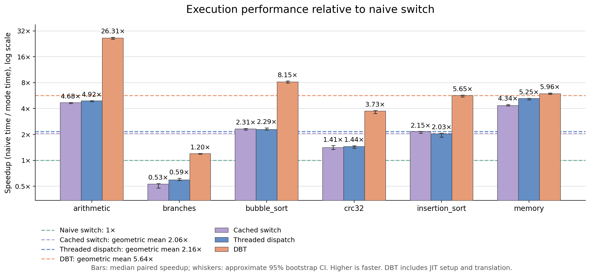

# SimCourse

SimCourse — функциональный симулятор архитектуры команд TIM, написанный на C++17.
Он загружает программы в формате ELF и моделирует выполнение их инструкций,
изменения регистров и обращения к памяти.

| Режим | Как исполняются инструкции | Флаг `simcourse` | Режим бенчмарка |
| --- | --- | --- | --- |
| Naive switch | Интерпретатор читает и декодирует каждую инструкцию при каждом исполнении. | Только в бенчмарке | `naive` |
| Cached switch | Интерпретатор использует кеш декодированных базовых блоков и выбирает обработчик каждой инструкции через `switch`. | По умолчанию | `switch` |
| Threaded | Интерпретатор использует те же декодированные блоки. Каждый обработчик передаёт управление следующему хвостовым вызовом (`clang::musttail`). | `--threaded` | `threaded` |
| Динамическая бинарная трансляция (DBT) | До порога блок исполняется в интерпретаторе. При достижении порога симулятор использует LLVM для генерации машинного кода хоста и кеширует результат. | `--dbt`, порог задаётся через `--threshold N` | `dbt` |

Гостевая программа может менять собственные инструкции (SMC). В режимах с
кешированием запись в защищённую страницу кода вызывает `SIGSEGV` и прерывает
текущий блок. Симулятор очищает кеш декодированных блоков, а в режиме DBT ещё
и кеш трансляций. Затем он исполняет прерванную инструкцию записи и продолжает
со следующей гостевой инструкции.

## Быстрый старт через Nix

Для сборки нужен Nix с включёнными flakes. Команды для Linux и WSL выполняются
из корня проекта.

```bash
# запуск примера фибоначчи в dbt режиме
nix build
./result/bin/simcourse tests/fibonacci.elf --dbt
```

`nix build` собирает симулятор и запускает тесты. Версии инструментов и библиотек
зафиксированы в `flake.lock`. Поддерживаются `x86_64-linux` и `aarch64-linux`.

`nix develop` открывает оболочку с Clang, LLVM, CMake, Ninja, Ruby и Python
с Matplotlib.

При переключении между системными инструментами и Nix пересоздайте конфигурацию
соответствующим пресетом CMake. Для бенчмарков это `cmake --fresh --preset benchmark`.

## Сборка без Nix

Нужны **CMake 3.24+**, **Ninja**, **Clang с поддержкой C++17 и `clang::musttail`**
(проверен Clang 18) и **LLVM 23.1.x** с заголовками и конфигурацией для CMake.
Для генерации гостевых программ и запуска бенчмарков нужен Ruby, для графиков —
Python 3 с Matplotlib. LLVM нужно установить заранее. CLI11, ELFIO,
cacheResearch и GoogleTest CMake скачает при первой конфигурации, если они
ещё не установлены.

В Ubuntu базовые инструменты можно установить через `apt`. Пакет `llvm-23-dev`
доступен в [репозитории LLVM для Ubuntu](https://apt.llvm.org/).

```bash
sudo apt update
sudo apt install clang cmake ninja-build ruby
```

После подключения репозитория LLVM установите `llvm-23-dev`, настройте и
соберите Release:

```bash
sudo apt install llvm-23-dev
cmake --preset release -DLLVM_DIR="$(llvm-config-23 --cmakedir)"
cmake --build --preset release --parallel
ctest --preset release
```

Результаты находятся в `build/release/`. Для Debug замените `release` на `debug`.

## Ассемблер TIM ISA

Подключите [Ruby DSL](rubyDSL/microAsm.rb) через `require_relative`. Опишите
инструкции, метки и данные в блоке `assembleElf(ARGV.fetch(0)) do ... end`.
Первый аргумент скрипта задаёт путь к выходному ELF.

```bash
ruby program.rb program.elf
./result/bin/simcourse program.elf
```

Пример скрипта с таким интерфейсом — [arithmetic.rb](benchmarks/workloads/arithmetic.rb).
Если вы собрали симулятор через CMake, используйте `./build/release/simcourse`
или `./build/debug/simcourse`.

В режиме `--dbt` параметр `--threshold` задаёт, сколько раз блок должен
выполниться в интерпретаторе до трансляции. По умолчанию это `1`. Значение `0`
означает трансляцию при первом входе в блок. Флаги `--dbt` и `--threaded`
используются по отдельности.

## Бенчмарки

`comparison` измеряет время исполнения во всех четырёх режимах и проверяет,
что по окончании совпадают значения регистров, счётчика команд и содержимое
памяти. Ускорение считается относительно naive switch. Каждый замер начинается
с пустых кешей, а время DBT включает инициализацию и трансляцию блоков.

```bash
# Сравнить все режимы на всех нагрузках.
nix develop -c ruby benchmarks/run.rb comparison --plot

# Проверить, как порог трансляции меняет ускорение DBT.
nix develop -c ruby benchmarks/run.rb threshold-sweep --plot
```

Раннер собирает `simcourse_bench` по пресету `benchmark`. Для выбора нагрузки
используйте `--case`, а для задания порогов в `threshold-sweep` — `--thresholds`.
Команды `ruby benchmarks/run.rb --list` и `ruby benchmarks/run.rb --help`
показывают доступные нагрузки и параметры.

Раннер сохраняет `results.json`, `report.md` и логи в
`benchmark-results/<UTC-время>/`. С `--plot` там же появится `dispatch-speedup`
или `threshold-speedup` в PNG и SVG. График можно построить по уже сохранённым
замерам.

```bash
nix develop -c python3 benchmarks/plot.py 'benchmark-results/<каталог-прогона>/results.json'
```

[отчёт по измерениям](benchmarks/results/dbt.md).


