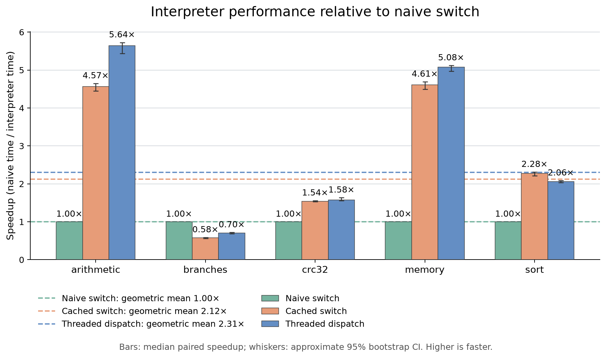

# Наивный, cached и threaded интерпретаторы

Сравнение текущих workloads, **11 октября 2026**. Ускорение нормировано
относительно наивного switch: `T_naive / T_mode`. Больше — быстрее;
наивная реализация всегда равна `1×`.



Столбцы показывают медианы парных отношений, отрезки — приблизительные
95%-е bootstrap CI. Пунктир — геометрическое среднее по пяти нагрузкам:
**2.12× для cached switch**, **2.31× для threaded**.

## Результаты

| Workload | Naive | Cached switch, ускорение [95% CI] | Threaded, ускорение [95% CI] |
| --- | ---: | ---: | ---: |
| arithmetic | 1× | 4.569× [4.446, 4.647] | 5.641× [5.435, 5.726] |
| branches | 1× | 0.578× [0.562, 0.588] | 0.701× [0.686, 0.719] |
| crc32 | 1× | 1.542× [1.531, 1.558] | 1.579× [1.561, 1.636] |
| memory | 1× | 4.608× [4.497, 4.691] | 5.075× [4.966, 5.121] |
| sort | 1× | 2.277× [2.213, 2.312] | 2.056× [2.030, 2.086] |

Кэш особенно полезен на длинных блоках arithmetic и memory: повторное
декодирование инструкций исключается. Threaded дополнительно сокращает
расходы диспетчеризации. На sort cached switch в этой серии быстрее threaded.

**Branches — обратный случай:** блоки очень короткие, поэтому обращения
к LIRS-кэшу происходят часто. Наивное исполнение здесь быстрее обоих вариантов
с кэшем. Это согласуется с затратами обслуживания кэша; их точную долю
следует подтверждать профилем. CRC32 и sort используют дорогой `BEXT`, поэтому
сокращение расходов dispatch даёт меньший относительный эффект.

## Методика

- **Naive:** fetch → decode → switch для каждой инструкции, без получения блоков из кэша.
- **Cached switch:** исполнение декодированного блока из LIRS-кэша через switch.
- **Threaded:** тот же кэш и общие операции, цепочка обработчиков с `musttail`.
- Один Clang 18.1.3 Release бинарник (`-O3 -DNDEBUG`), WSL2 Ubuntu 24.04,
  AMD Ryzen 7 8845H; CPU affinity — логическое ядро 2.
- 31 измеренная тройка после двух прогревочных; чередуются все шесть порядков.
  Для каждого исполнения создаётся новый симулятор, кэш изначально холодный.
- Таймер охватывает `runSimulation()`. Загрузка ELF и внешнее сравнение
  состояния выполняются вне таймера; встроенные проверки golden data входят в него.
- Регистры, PC и память совпали во всех тройках. CRC32 и sort прошли проверки
  по эталонам в ELF. CI: percentile bootstrap, 10 000 перевыборок, seed 0.

Это результаты одной серии на одной машине; CI не учитывают систематическую
ошибку и изменение условий между сериями. Среднее характеризует именно этот набор.

## Запуск и артефакты

```bash
ruby benchmarks/run.rb comparison --samples 31 --warmups 2 --timeout 120 --plot
```

Для `--plot` нужны Python 3 и Matplotlib. Отдельное построение по сохранённым данным:

```bash
python3 benchmarks/plot.py benchmarks/results/naive-comparison-2026-10-11.json
```

В этой серии из-за прав общей Windows-папки бинарник собран в
`~/build/simCourse/benchmark`; раннер запущен через `taskset -c 2` с `--binary`.

[Сырые замеры, статистика и SHA-256](results/naive-comparison-2026-10-11.json) ·
[PNG](plots/dispatch-speedup.png) · [SVG](plots/dispatch-speedup.svg)
